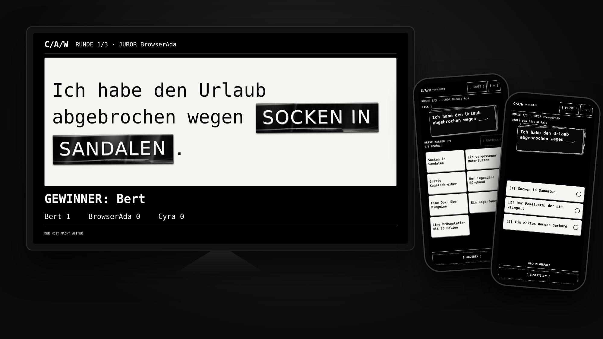
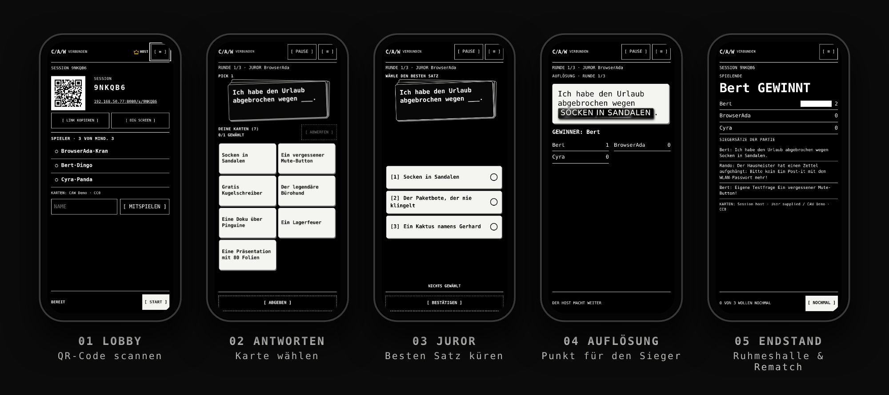
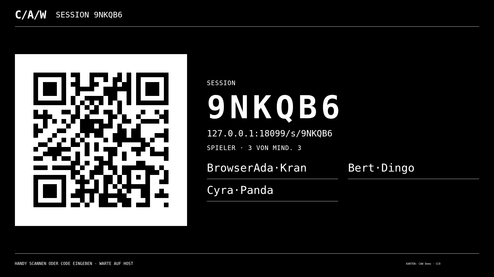
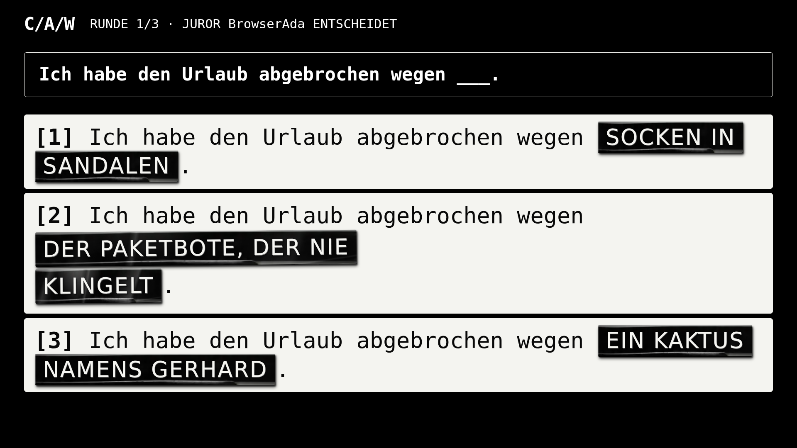
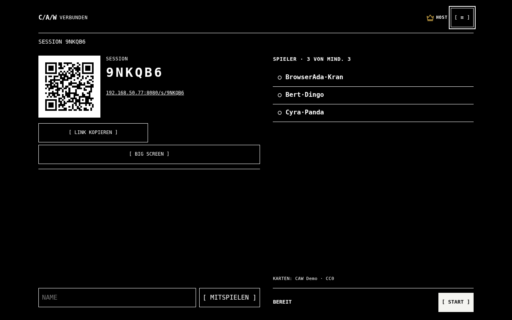
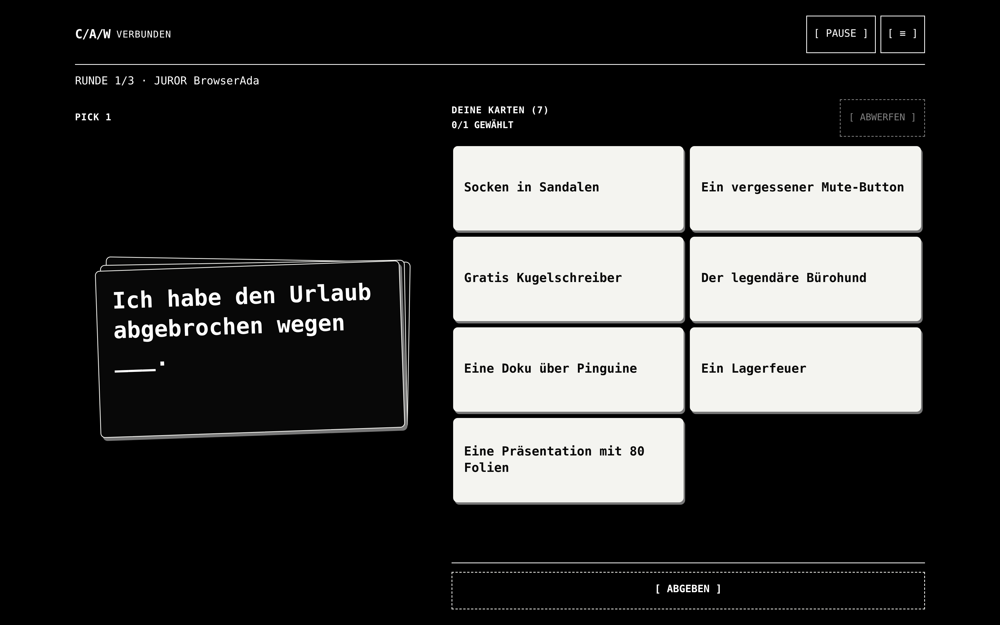
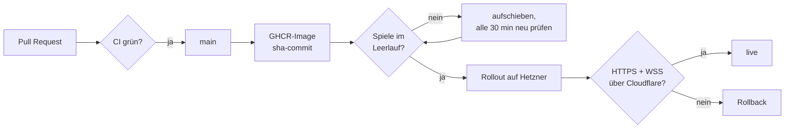
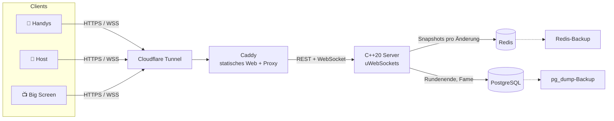

<div align="center">

# C/A/W · Cards Against Whatever

**Das Partyspiel für 3–8 Handys im Browser, mit optionalem Big Screen.**
QR-Code scannen, Karte wählen, lachen. Keine App, kein Konto, kein Build-Schritt.

[](https://caw.obivan.org)
[](https://github.com/0b-ivan/CAW/deployments/production)
[](https://github.com/0b-ivan/CAW/actions/workflows/ci.yml)
[](https://github.com/0b-ivan/CAW/actions/workflows/deploy-hetzner.yml)
[](https://github.com/0b-ivan/CAW/actions/workflows/redis-backup-audit.yml)
<br>


[](LICENSE)

**[▶ Jetzt spielen: caw.obivan.org](https://caw.obivan.org)**



</div>

---

## Inhalt

- [So funktioniert's](#so-funktionierts)
- [Screenshots](#screenshots)
- [Features](#features)
- [Deployment-Status](#deployment-status)
- [Architektur](#architektur)
- [Schnellstart lokal](#schnellstart-lokal)
- [Produktion auf Hetzner](#produktion-auf-hetzner)
- [Entwicklung und Tests](#entwicklung-und-tests)
- [Server-Protokoll](#server-protokoll)
- [Kartenpacks und Lizenzen](#kartenpacks-und-lizenzen)
- [Dokumentation](#dokumentation)

## So funktioniert's



1. **Session anlegen:** Am Laptop oder Handy `[ NEUE SESSION ]`. Die Seite
   zeigt QR-Code, sechsstelligen Code und Link.
2. **Beitreten:** Drei bis acht Handys scannen den QR-Code und treten mit
   Namen bei. Der Host kann mit `[ MITSPIELEN ]` selbst einen Platz nehmen.
3. **Spielen:** Jede Runde zeigt eine schwarze Frage. Alle außer dem Juror
   legen ihre beste weiße Karte, der Juror kürt anonym den besten Satz.
4. **Big Screen (optional):** Ein TV oder Beamer öffnet `/s/XXXXXX/screen`
   und zeigt Frage, Uhr, eingesetzte Sätze und Endstand, aber nie eine Hand.

Ein Reload oder ein kurzer Netzabbruch kostet keinen Platz: Das Sitz-Ticket
liegt im `localStorage`. Regeln stellt der Host im Menü `[ ≡ ]` →
SPIELREGELN ein.

## Screenshots

<table>
  <tr>
    <td width="50%"></td>
    <td width="50%"></td>
  </tr>
  <tr>
    <td align="center"><sub><b>Big Screen · Lobby</b>: QR-Code für alle im Raum</sub></td>
    <td align="center"><sub><b>Big Screen · Juror-Phase</b>: anonyme Sätze, Antworten als Prägeband</sub></td>
  </tr>
  <tr>
    <td></td>
    <td></td>
  </tr>
  <tr>
    <td align="center"><sub><b>Desktop · Host-Lobby</b>: Einladung neben der Spielerliste</sub></td>
    <td align="center"><sub><b>Desktop · Antworten</b>: Frage links, Hand rechts</sub></td>
  </tr>
</table>

<sub>Die Screenshots stammen aus einer echten, automatisiert gespielten Partie
(`web/tests/play.cjs`). Gespielt wurde mit einem harmlosen Demo-Deck; die
mitgelieferten Packs sind deutlich derber.</sub>

## Features

| | |
|---|---|
| 📱 **Ein Handy pro Person** | Keine App, kein Konto. Beitritt per QR-Code oder Code. Jede Ansicht passt ohne Scrollen auf 320 px. |
| 📺 **Big Screen** | TV, Beamer oder Laptop zeigt nur öffentliche Daten; fertig für 16:9 und 4:3. |
| ⚡ **Autoritativer C++-Server** | uWebSockets, ein Event-Loop besitzt alle Räume. Clients schicken Absichten, nie Ergebnisse. |
| 💾 **Nichts geht verloren** | Jede Änderung wird in Redis gesichert. Nach Neustart oder Reload holt sich jeder seinen Sitz zurück. |
| 🃏 **Kartenpacks** | Sechs deutsche Cards-vs-Humanity-Sets, mischbar, dazu eigene Karten des Hosts (Editor mit JSON-Import/-Export). |
| 🏆 **Ruhmeshalle** | Statistik und Siegersätze in PostgreSQL. |
| 🌍 **Deutsch und Englisch** | Alle UI-Texte über Übersetzungstabellen. |
| 🔒 **Betrieb** | Caddy, Cloudflare Tunnel ohne offenen Origin-Port, Rate-Limits, Prometheus-Alarme, tägliche Backups mit Restore-Audit. |

## Deployment-Status

| Umgebung | URL | Status | Auslieferung |
|---|---|---|---|
| **Produktion** | [caw.obivan.org](https://caw.obivan.org) | [](https://caw.obivan.org/healthz) | Hetzner Cloud via Cloudflare Tunnel |
| **Image** | `ghcr.io/0b-ivan/caw-server:sha-<commit>` | [](https://github.com/0b-ivan/CAW/actions/workflows/deploy-hetzner.yml) | unveränderlich, ein Tag pro Commit |
| **CI auf `main`** | – | [](https://github.com/0b-ivan/CAW/actions/workflows/ci.yml) | CTest, Format, Compose-Smoke, Playwright, Lasttest, Restore |

**Pipeline:** Nach grüner CI auf `main` baut `Deploy CAW to Hetzner` das
GHCR-Image und aktualisiert CAW per SSH. Ein halbstündlicher Lauf holt
aufgeschobene Rollouts nach. Redis, PostgreSQL und der Tunnel werden nicht neu
erstellt. Laufende Partien werden nicht unterbrochen: Der Rollout wartet auf
Leerlauf, und ein fehlgeschlagener Health- oder WSS-Check rollt zurück.



**Letzte Abnahme:** [Produktionsabnahme 02.11.2026](docs/validation/PRODUCTION-2026-11-02.md).

**In Arbeit:**

- [#43 Blue/Green-Deploy mit sessionsicherem WebSocket-Drain](https://github.com/0b-ivan/CAW/issues/43)
  ersetzt das Warten auf Leerlauf; erster Schritt als Draft in
  [#44](https://github.com/0b-ivan/CAW/pull/44).
- [#16 Kartenvorschläge der Spieler mit Host-Freigabe](https://github.com/0b-ivan/CAW/pull/16).
- Noch offen: verschlüsselte Offsite-Backups, Touch-Abnahme auf echten
  Android-/iPhone-Geräten, abschließende Prüfung der Kartenrechte.

## Architektur



| Teil | Technik |
|---|---|
| Backend `server/` | C++20, CMake, uWebSockets, nlohmann/json, libpqxx, redis-plus-plus, doctest |
| Spielregeln `server/src/game/` | aus der X4-Firmware (`0b-ivan/inx-4x-pro`) übernommen, samt Tests |
| Frontend `web/` | statisches HTML, CSS, JS-Module, kein Framework, kein Build |
| Betrieb `deploy/` | Docker Compose: Caddy, Server, Redis, PostgreSQL, Backup-Worker, optional Prometheus |

Der heiße Pfad läuft ohne Datenbank: Aktion → Spielregeln → Frames →
Snapshot in die Warteschlange. Details in
[KONZEPT-CPP-BACKEND.md](docs/KONZEPT-CPP-BACKEND.md).

## Schnellstart lokal

Voraussetzung: Docker mit Compose v2.

```sh
cp .env.example deploy/.env
# POSTGRES_PASSWORD in deploy/.env durch einen zufälligen URL-sicheren Wert ersetzen
docker compose -f deploy/compose.dev.yml up --build --wait
```

| | |
|---|---|
| Startseite | http://localhost:8080 |
| Bereitschaft | `/healthz` |
| Metriken | `/metrics` (nur lokal, extern immer 404) |

Die statischen Dateien sind als Volume eingebunden; nach einer Änderung genügt
Neuladen. C++-Änderungen brauchen einen erneuten Build (Debug-Profil). Für
Handys im WLAN statt `localhost` die IP des Rechners verwenden.

## Produktion auf Hetzner

Die Produktion läuft über den **bestehenden Cloudflare Tunnel des
Hetzner-Servers**. `deploy/compose.hetzner.yml` bindet Caddy nur an
`127.0.0.1:18081`; es gibt keinen öffentlichen Origin-Port und keinen
A-/AAAA-Eintrag auf die Hetzner-IP.

```sh
cp deploy/hetzner/env.example deploy/.env
# Passwort (openssl rand -hex 32) einsetzen, Betreiberangaben ergänzen
python3 bin/hetzner-preflight.py --prepare
docker compose -p caw -f deploy/compose.yml -f deploy/compose.hetzner.yml up --build -d --wait
python3 bin/hetzner-preflight.py --public
node bin/hetzner-wss-check.mjs
```

> [!WARNING]
> **Nicht** `docker compose -f deploy/compose.yml up` als öffentliche
> Produktion starten: Das Basis-Compose veröffentlicht Entwicklungsports.

Vollständige Anleitung, automatische Updates und Rückroll-Verfahren:
[Hetzner + Cloudflare Tunnel](docs/operations/HETZNER-CLOUDFLARE.md).

<details>
<summary><b>Betrieb im Detail</b> (Domain, Impressum, Backups, Monitoring, Releases)</summary>

- **Domain und TLS ohne Tunnel:** In `deploy/.env`
  `CADDY_ADDRESS=caw.obivan.org`, `PUBLIC_URL=https://caw.obivan.org`,
  `HTTP_PORT=80`, `HTTPS_PORT=443`. Caddy holt das Zertifikat selbst.
- **Impressum:** `cp web/operator.example.json web/operator.json` und Name,
  Anschrift, E-Mail eintragen (nicht im Repo). Lizenzen und Datenschutz kommen
  ohne Zutun.
- **Backups:** Der Dienst `backup` sichert PostgreSQL täglich (14 Tage), der
  Dienst `redis-backup` die Redis-RDB. Zurückspielen:
  `bin/restore caw-<zeit>.dump` oder zur Kontrolle erst
  `bin/restore caw-<zeit>.dump caw_check`. Ein geplanter Workflow prüft die
  Redis-Backups in einer isolierten Wiederherstellung.
- **Monitoring:** `docker compose -f deploy/compose.yml --profile monitoring up -d`
  startet Prometheus mit den Alarmregeln aus `deploy/monitoring/` auf
  `127.0.0.1:9090`.
- **Release-Image:** Ein Tag `v*` baut `ghcr.io/0b-ivan/caw-server`. Mit
  `CAW_VERSION=v1.0.0 docker compose -f deploy/compose.yml pull server`
  statt `--build`.
- **Freigabe der Automatik:** Der Rollout braucht das GitHub-Environment
  `production` mit dediziertem SSH-Schlüssel und geprüften `known_hosts`
  sowie die Repository-Variablen `CAW_PRODUCTION_APPROVED=true` und
  `CAW_AUTO_DEPLOY=true`. Ohne sie verändert auch ein Merge nach `main`
  keinen Server.

</details>

## Entwicklung und Tests

Unter Debian 13: `build-essential`, `cmake`, `ninja-build`, `git`,
`ca-certificates`, `libpqxx-dev`, `libhiredis-dev`, `zlib1g-dev`,
`nlohmann-json3-dev`, `doctest-dev`, optional `clang-format`, `clang-tidy`.

```sh
cmake -S server -B build -DCMAKE_BUILD_TYPE=Debug
cmake --build build -j 2
ctest --test-dir build --output-on-failure
./bin/format
```

Ohne Datenbank-Clients lassen sich Regeln, Snapshots und Konfiguration mit
`-DCAW_BUILD_SERVER=OFF` prüfen. Mit Docker:

```sh
docker build --target build -t caw-build -f deploy/server.Dockerfile .
docker run --rm caw-build ctest --test-dir /app/build --output-on-failure
docker run --rm caw-build ./bin/lint
./bin/smoke
```

| Prüfung | Was sie abdeckt |
|---|---|
| `ctest` | Spielregeln aus der Firmware, Protokoll, Snapshots, Persistenz |
| `web/tests/landing.cjs` | Startseite DE/EN, Tastatur, Tippziele, Überlauf bei 320/390/1280 px |
| `web/tests/play.cjs` | Host + 3 Handys + Big Screen spielen eine ganze Partie: Reload, Pause, Juror, Endstand, Rematch, Entfernen, Sprache. Mit `CAW_SCREENSHOT_DIR` entstehen Screenshots jeder Ansicht. |
| `bin/smoke` | Caddy, Ausfall und Wiederanlauf von Redis und PostgreSQL (nur Testinstanz) |
| `tests/load/load.mjs` | 1 000 Räume mit je 8 Bots gegen die Budgets aus [KONZEPT.md](docs/KONZEPT.md) 5a |

Für den Lasttest `RATE_LIMIT_PER_MINUTE` hoch setzen:
`node tests/load/load.mjs http://localhost:8080 1000 3`. Eigene Ports für
Smoke- und Browsertests über `CAW_SMOKE_URL`.

## Server-Protokoll

Zwei REST-Routen und der Spiel-WebSocket:

```sh
curl -sS -H 'Content-Type: application/json' -d '{"language":"de"}' \
  http://localhost:8080/api/sessions
# -> {"code":"XXXXXX","hostToken":"<32 geheime Hex-Zeichen>"}

curl -sS http://localhost:8080/api/sessions/XXXXXX
# -> {"code":"XXXXXX","language":"de","phase":"lobby"}
```

<details>
<summary><b>Details zu Sessions, WebSocket und Persistenz</b></summary>

Der private Host-Token wird nur beim Anlegen zurückgegeben, nicht im
öffentlichen GET. Sechsstellige Codes verwenden ein eindeutiges
31-Zeichen-Alphabet; die 128-Bit-Host-Tokens kommen aus Betriebssystemzufall.
Leere oder unerwartete JSON-Felder werden abgelehnt. Ein abgelaufener Code
wird wie ein unbekannter behandelt.

Gespielt wird über `ws://…/ws/XXXXXX` (Befehle und Antworten:
[KONZEPT-CPP-BACKEND.md](docs/KONZEPT-CPP-BACKEND.md) Abschnitt 7). Ein
Spieler tritt mit `{"type":"join","name":"Ada"}` bei, der Host meldet sich mit
`{"type":"host","token":"…"}` an und startet mit `{"type":"start"}`. Ohne
Pack-Dateien (`PACKS_DIR` leer) spielt der Server mit nummerierten
Testkarten.

Laufende Partien werden nach jeder Änderung in Redis gesichert
(`session:XXXXXX`, verfällt nach `SESSION_TTL_HOURS` ohne Aktivität). Nach
einem Neustart holen sich die Handys ihren Sitz mit
`{"type":"resume","token":"…"}` zurück. Bei SIGTERM schließt der Server alle
Sockets und schreibt ausstehende Stände, bevor er endet.

</details>

## Kartenpacks und Lizenzen

Der Server lädt beim Start alle Packs aus `PACKS_DIR` (im Image
`assets/cardpacks`, je Quelle ein `packs.json` mit Lizenz und Rechteinhaber).
Eine neue Session spielt alle Packs ihrer Sprache; der Host ändert das in der
Lobby unter `≡` → KARTEN-PACKS. Rechteinhaber und Lizenz stehen in Lobby und
Endstand.

| Bestandteil | Lizenz |
|---|---|
| CAW-Code | [MIT](LICENSE) |
| Spielregeln aus der X4-Firmware | MIT ([`LICENSE.upstream`](server/src/game/LICENSE.upstream), Herkunft in [UPSTREAM.md](server/src/game/UPSTREAM.md)) |
| Sechs deutsche Cards-vs-Humanity-Sets | CC BY-NC-SA 2.0, nur nichtkommerziell ([Quellen](docs/cardpacks/CARDS-VS-HUMANITY.md)) |
| Prior99-Import (opt-in, nur für Erwachsene) | Rechte noch nicht abschließend geklärt ([PRIOR99.md](docs/cardpacks/PRIOR99.md)) |

Die Original-CSVs liegen unter `assets/cardpacks/cards-vs-humanity/` mit
`ATTRIBUTION.md` und `SHA256SUMS`. Aktualisieren:

```sh
python3 bin/fetch-cvh-sets.py --list
python3 bin/fetch-cvh-sets.py
python3 -m unittest discover -s tests -p 'test_*cvh*.py'
```

Alle Test-Fixtures sind synthetisch. Bei öffentlichem Betrieb sind die
Kartenrechte zu prüfen (nichtkommerziell, Namensnennung).

## Dokumentation

| Dokument | Inhalt |
|---|---|
| [KONZEPT.md](docs/KONZEPT.md) | Regeln, Performance-Budgets |
| [KONZEPT-CPP-BACKEND.md](docs/KONZEPT-CPP-BACKEND.md) | C++-Backend, hat Vorrang bei Technikfragen |
| [UI-KONZEPT.md](docs/UI-KONZEPT.md) | Gestaltung, Ansichten, Big Screen |
| [ROADMAP.md](docs/ROADMAP.md) · [TODO.md](docs/TODO.md) | Meilensteine M0–M9 und offene Punkte |
| [HETZNER-CLOUDFLARE.md](docs/operations/HETZNER-CLOUDFLARE.md) | Produktion, Automatik, Rollback |
| [docs/validation/](docs/validation/) | Prüfberichte und Abnahmen |
| [CLAUDE.md](CLAUDE.md) | Hinweise für Agenten |

<div align="center">
<sub>Monochrom, Monospace, Linien statt Kästen. Gebaut für Spieleabende.</sub>
</div>
